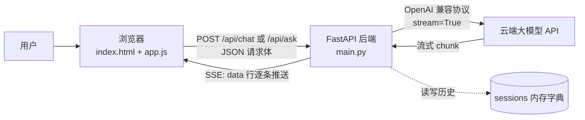

# Mini Qwen —— 极简千问聊天应用（新手学习版）

> 本文档基于项目**当前实际代码**整理，目标是帮助新手理解：一个"前端聊天页面 + 后端转发大模型"的最小项目是如何一步步搭起来的，每一步**做什么**、**为什么这样做**、**容易踩什么坑**。

---

## 1. 项目简介

### 1.1 这个项目是什么

Mini Qwen 是一个**没有前端框架、没有数据库、后端只有一个文件**的最小 AI 聊天应用。前端用浏览器直接打开即可运行，后端用 FastAPI 提供接口，真正的"智能"来自云端大模型 API——本项目只做"转发 + 状态管理 + 流式传输"。

### 1.2 已实现的基础能力

| 能力 | 说明 | 对应代码位置 |
|---|---|---|
| 前端聊天界面 | 消息气泡、输入框、发送/停止按钮，纯原生实现 | `frontend/index.html` + `style.css` |
| 多轮闲聊 | 同一 `session_id` 内后端记住上下文，模型能"接着聊" | 后端 `/api/chat` + `sessions` 字典 |
| 单轮问答 | 每次请求独立、不带历史，适合 FAQ/题库类问题 | 后端 `/api/ask` |
| 流式输出 | AI 回复像打字机一样逐字出现，而不是等全部生成完 | 后端 `StreamingResponse` + 前端 `reader.read()` |
| 停止生成 | 生成过程中点"停止"可中断请求，保留已生成内容 | 前端 `AbortController` |
| 会话 ID 维护 | 后端生成 UUID 并通过响应头 `X-Session-Id` 返回给前端 | 后端接口 + 前端 `sessionId` 变量 |
| 历史裁剪 | 会话过长时只保留最近 N 轮，防止 token 超限 | 后端 `_trim()` |
| 模式切换 | 页面顶部 Tab 一键切换"闲聊 / 单轮问答" | 前端 Tab 事件绑定 |

### 1.3 适合学习什么

- 最简**前后端联调**：浏览器 fetch → FastAPI 接口 → 云端模型 → 原路返回
- **FastAPI 接口开发**：Pydantic 参数校验、流式响应、CORS 中间件、自动接口文档
- **OpenAI 兼容接口**的调用方式（换模型服务商只改配置不改代码）
- **SSE 流式协议**：`data: {...}\n\n` 格式、`[DONE]` 结束标记
- 浏览器用 `fetch + ReadableStream` 手动解析流式数据
- **跨域与响应头暴露**问题：为什么 Network 面板看得到 `X-Session-Id`，JS 却读到 `null`

---

## 2. 技术栈说明

### 2.1 前端：HTML + CSS + 原生 JavaScript

**没有引入 React/Vue，也没有构建工具（webpack/vite）**，原因：

- 页面只有"一个消息列表 + 一个输入框"，组件状态极少，框架的收益覆盖不了一次构建配置的成本；
- 零构建 = 浏览器双击 `index.html` 就能跑，新手排查问题时看到的代码就是运行的代码，中间没有编译"黑盒"；
- 学习价值更直接：手写 SSE 解析、手写 DOM 更新，才能真正理解框架帮你做了什么。

### 2.2 后端：Python + FastAPI 全家桶

| 技术 | 在项目中的角色 | 新手为什么要理解它 |
|---|---|---|
| **FastAPI** | Web 框架，定义 4 个接口 | 自带参数校验 + 自动接口文档（`/docs`），学习成本低于 Flask/Django |
| **Uvicorn** | ASGI 服务器，运行 FastAPI 应用 | `main.py` 底部的 `uvicorn.run(...)` 就是启动它；`reload=True` 支持改代码自动重启 |
| **Pydantic**（`BaseModel`） | `ChatIn` / `AskIn` 两个请求模型 | 声明字段和类型后，FastAPI 自动完成 JSON 解析 + 类型校验，非法请求直接返回 422 |
| **AsyncOpenAI** | 调用云端大模型的 SDK（异步版） | 因为后端要"边读模型流边写浏览器流"，异步能在等待网络时不阻塞其他请求 |
| **python-dotenv** | `load_dotenv()` 读取 `.env` 配置 | 把密钥、模型名从代码里挪到配置文件，避免硬编码进 git |
| **logging** | 接口关键位置打印日志 | 前后端联调出问题时，日志是第一手证据（详见 8.6 节） |

### 2.3 模型服务：OpenAI 兼容接口协议

后端通过 `AsyncOpenAI(base_url=BASE_URL, ...)` 调用云端模型。这里的关键设计是**使用 OpenAI 兼容协议**（`/v1/chat/completions`）而不是某厂商私有协议：

- **为什么？** 现在几乎所有模型服务（阿里云百炼、DeepSeek、硅基流动、本地 Ollama/vLLM）都提供 OpenAI 兼容入口。只要协议兼容，将来切换服务商**只改 `.env`/配置里的 `BASE_URL` 和模型名，代码一行不动**。
- 本项目默认 `BASE_URL` 指向自建网关（`https://maas.qianwenaiapi.com/compatible-mode/v1`），模型名为 `deepseek-v4-pro-0813`。

**为什么密钥必须放后端、由后端转发？**

浏览器里所有 JS 代码（包括打包产物）用户都能在 DevTools 里看到，把 API Key 写进前端 = 把 Key 公开。任何人拿到你的 Key 就能刷你的付费额度。正确姿势只有一种：**前端只调自己的后端，后端持有 Key 代为请求**。这是所有 AI 应用（哪怕最小的 Demo）都要遵守的安全边界。

### 2.4 会话存储：内存字典

```python
sessions: dict[str, list[dict]] = {}   # key = 会话ID(UUID)，value = 消息列表
```

- **为什么用内存字典？** Demo 阶段它 3 行代码就能实现"多轮记忆"，不需要引入任何中间件，让学习者把注意力放在"会话状态"这个**概念**上而不是存储选型上。
- **局限（当前项目适合学习，生产环境建议改进）**：
  1. 进程重启 → 所有会话丢失；
  2. 多实例部署（负载均衡）→ 请求 A 打到实例 1、请求 B 打到实例 2，会话对不上；
  3. 无容量上限 → 长期运行内存只增不减。
- 生产环境可替换为 **Redis**（推荐，天然适合带过期时间的会话）或**关系型数据库**（需要持久化聊天记录时）。替换点只在 `sessions` 字典的读写处，接口逻辑不用动。

---

## 3. 项目目录结构

```
mini_qianwen/
├── backend/
│   ├── main.py        # FastAPI 后端服务主文件（全部后端逻辑，约 200 行）
│   └── test.py        # 环境连通性测试脚本（验证 Key / BASE_URL 是否可用）
├── frontend/
│   ├── index.html     # 页面结构与 DOM 骨架
│   ├── style.css      # 页面样式与布局
│   └── app.js         # 前端交互逻辑：请求发送、流式接收、模式切换
└── readme             # 早期需求笔记（方案构思记录）
```

> **建议补充**：当前项目还没有 `requirements.txt` 和 `.env` 文件。为提升可维护性，后续可补充 `backend/requirements.txt`（依赖清单）和 `backend/.env`（配置文件），并将代码中硬编码的 `API_KEY` 迁移进去。详见第 12 节。

各文件职责详解：

| 文件 | 职责 | 新手关注点 |
|---|---|---|
| `backend/main.py` | 定义 `/api/chat`、`/api/ask`、`/api/sessions`、`/api/session/{sid}` 四个接口；配置 CORS；管理内存会话；把 OpenAI 流转成 SSE | 后端全部逻辑都在这一份文件里，建议按"配置区 → 模型区 → 工具函数区 → 接口区"的顺序阅读 |
| `backend/test.py` | 用同步 `OpenAI` 客户端发一条最简消息，验证密钥和地址是否正确 | 联调前**先跑它**。如果 test.py 都失败，说明问题在 Key/网络，而不是业务代码 |
| `frontend/index.html` | 定义 header（标题+Tab+新对话按钮）、消息列表 `#list`、footer（输入框+发送/停止按钮）三段结构 | 只有 33 行，先看懂 DOM 结构再看 JS 操作了哪些元素 |
| `frontend/style.css` | flex 纵向三段式布局、气泡左右对齐配色、按钮显隐 | 重点看 `.app` 的 flex 列布局和 `.msg` 的 `align-self` |
| `frontend/app.js` | 模式切换、发送请求、解析 SSE 流、停止生成、状态恢复 | 核心是 `send()` 函数，占了全文件 60% 的信息量 |
| `readme`（根目录） | 项目立项时的方案笔记：三个先决决策（云端 API、兼容协议、密钥不进前端）与文件规划 | 可当作"设计文档"来读，理解项目为什么长这样 |

---

## 4. 整体架构与调用流程

### 4.1 架构图



### 4.2 一次"闲聊"请求的完整生命周期

1. 用户在输入框打字，按 **Enter**（或点"发送"）；
2. 前端 `send()` 根据当前 `mode === "chat"`，向 `http://localhost:8000/api/chat` 发 POST，请求体为 `{message, session_id}`；
3. 后端 FastAPI 用 Pydantic 模型 `ChatIn` **校验入参**（缺 `message` 字段直接返回 422，轮不到业务代码处理）；
4. 后端取 `session_id`（没有就生成 UUID），从 `sessions` 取出历史、追加本轮用户消息、`_trim()` 裁剪；
5. 后端带着完整消息列表调用大模型，`stream=True` 拿到一个**异步迭代器**；
6. `_stream_to_browser()` 每收到一个 chunk，就提取增量文本，转成一行 SSE：`data: {"content":"..."}\n\n`；
7. `StreamingResponse` 把这些行持续推给浏览器，同时响应头带上 `X-Session-Id`；
8. 前端用 `res.body.getReader()` 循环读取字节流，按行解析 `data:`，把 `content` 不断累加进 AI 气泡——实现打字机效果；
9. 流结束时后端补发 `data: [DONE]\n\n`，前端读到 `done=true` 退出循环，恢复输入框。

### 4.3 "多轮闲聊"与"单轮问答"的本质区别

| 维度 | chat（闲聊） | ask（单轮问答） |
|---|---|---|
| 是否读写 `sessions` | ✅ 读写历史 | ❌ 完全不碰 |
| 发给模型的消息 | system + 最近 N 轮历史 + 本轮输入 | system + 仅本轮问题 |
| 会话 ID | 有（`X-Session-Id`） | 无 |
| `temperature` | 0.7（回答要自然发散） | 0.3（回答要稳定可复现） |
| `max_tokens` | 1024（闲聊回复短） | 2048（问答可能需要长答案） |
| 系统提示词 | `SYSTEM_CHAT`（幽默、200 字内） | `SYSTEM_QA`（分点作答、不延伸） |

**为什么拆成两个接口，而不是一个接口加 `if memory=True` 参数？**

1. **边界清晰**：两者本质是两套不同的"会话状态机"——一个有状态、一个无状态。混在一个接口里，参数组合会指数级膨胀（是否带历史？带多少？温度用哪个？提示词用哪个？），后期每加一种模式都要改老代码；
2. **演进方向不同**：代码注释里写明了——`/api/ask` 是将来**挂 RAG（检索增强）**的位置，`/api/chat` 是将来接**长期记忆/用户画像**的位置。分开放，各自扩展互不干扰；
3. **符合 REST 语义**：不同资源/行为用不同路径，前端按模式选 URL 即可（`app.js` 第 85 行就是一行三元表达式），不需要额外参数约定。

---

## 5. 前端页面布局说明

### 5.1 index.html 的区域划分

```
┌────────────────────────────────────────┐
│ <header>                               │
│  Mini Qwen   [💬 闲聊] [❓ 单轮问答]  ＋ 新对话 │
├────────────────────────────────────────┤
│                                        │
│         <div id="list">                │  ← 消息列表（唯一会持续变长的区域）
│        （聊天气泡渲染在这里）             │
│                                        │
├────────────────────────────────────────┤
│ <footer>                               │
│  [textarea#input 输入框……]              │
│  提示文案#hint          [发送] [停止]     │
└────────────────────────────────────────┘
```

| 元素 | 作用 | 为什么这样设计 |
|---|---|---|
| `<h1>Mini Qwen</h1>` | 标题 | `margin-right: auto` 把它推向左侧，给右侧按钮留空间 |
| `.tab`×2（`data-mode`） | 模式切换 | 用 `data-mode` 属性存模式值，JS 读 `btn.dataset.mode`——**行为数据放 HTML、逻辑放 JS**，避免在 JS 里硬编码按钮文案判断 |
| `#btnNew` | 新对话 | 用 `.ghost`（透明描边）样式与主操作区分层级 |
| `#list` | 消息容器 | 用 `<div>` 而非 `<ul>`：消息不是可选择的列表项，本质是连续内容块 |
| `#input`（textarea） | 输入框 | 用 `<textarea>` 而不是 `<input>`：**支持 Shift+Enter 换行**输入多行内容 |
| `#hint` | 模式提示 | 切换模式时改变文案，让用户明确当前上下文规则，防止"为什么它不记得了"的困惑 |
| `#btnSend` / `#btnStop` | 发送/停止 | 两个按钮占同一位置、用 `hidden` 属性互换（HTML 里 `#btnStop` 初始 `hidden`），见 5.3 |

### 5.2 style.css 布局实现

**整体三段式（核心是 `.app` 的 flex 列布局）：**

```css
.app { max-width: 720px; margin: 0 auto; height: 100vh;
       display: flex; flex-direction: column; }
.list { flex: 1; overflow-y: auto; }
```

- `height: 100vh` + `flex-direction: column`：页面占满一屏、纵向排三段；
- `#list` 用 `flex: 1` 吃掉所有剩余高度，`overflow-y: auto` 让内容超长时**只有中间滚动**——header 和 footer（输入区）自然被"固定"在上下两端。这是聊天界面的标准布局方案，不需要 `position: fixed`；
- `max-width: 720px; margin: 0 auto`：限制阅读宽度并居中，手机上自动占满。

**消息气泡左右对齐（一行 CSS 解决）：**

```css
.msg { max-width: 82%; align-self: ... }
.msg.user    { align-self: flex-end;   background: #1d1d1f; color: #fff; }  /* 右对齐深色 */
.msg.ai      { align-self: flex-start; background: #f0f0f2; }                /* 左对齐浅灰 */
.msg.system  { align-self: center; font-size: 12px; color: #888; }           /* 居中灰字 */
```

因为 `#list` 是 `flex-direction: column` 容器，子元素用 `align-self` 即可控制交叉轴（水平）位置，无需 float 或 margin:auto 技巧。`max-width: 82%` 防止单条消息占满整行失去"对话感"。

**其他细节：**

- `.msg` 的 `white-space: pre-wrap`：**保留模型输出中的换行符**——没有它，模型的分点回答会挤成一行；`word-break: break-word` 防止超长 URL 撑爆气泡；
- 每次追加新消息后 JS 执行 `$list.scrollTop = $list.scrollHeight` 强制滚动到底部（`app.js` 的 `append()` 和流式更新处）；
- `.tab.active` 黑底白字：用类切换实现选中态，JS 只负责增删 class，样式规则全部收敛在 CSS。

### 5.3 按钮显隐如何体现"发送中"状态

```js
// 发送时
$send.hidden = true;  $stop.hidden = false;  $input.disabled = true;
// finally 里恢复
$send.hidden = false; $stop.hidden = true;   $input.disabled = false;
```

同一位置只显示"发送"或"停止"之一，配合输入框禁用，传达一个明确语义：**当前有一条请求在进行中**。输入框禁用还有一个功能原因：防止用户在响应期间连发多条消息——后端是"追加历史"模式，并发请求会交叉写入同一会话，导致历史顺序错乱。

---

## 6. 前端核心代码逻辑说明（app.js）

### 6.1 关键变量

```js
const API = "http://localhost:8000";   // 后端地址：改部署位置只需改这一行
let mode = "chat";                     // 当前模式："chat" | "ask"
let sessionId = null;                  // 闲聊会话 ID，由后端响应头返回
let aborter = null;                    // 当前请求的 AbortController

// DOM 元素引用（$ 前缀是习惯性简写，代表"已缓存的 DOM 节点"）
const $list, $input, $send, $stop, $hint, $newBtn = ...
```

- **为什么 `sessionId` 初始为 `null`？** 表示"还没有会话"。第一次发消息时后端发现没带 ID，会生成新 UUID 并通过 `X-Session-Id` 头返回，前端记下后，后续请求都带着它 → 服务端才知道"这是同一个对话"。**会话 ID 由后端生成**的原因：会话数据在服务端，前端只持有一个不可猜测的"凭证"（UUID），天然避免了前端伪造/重复 ID 的问题。
- **为什么要把 DOM 提前存成变量？** 只在初始化时查询一次，避免每次发消息都重复 `getElementById`，也让后续代码可读性更好。

### 6.2 主要交互逻辑

#### Tab 模式切换（第 19-29 行）

点击后做四件事：移除旧 Tab 的 `active` 类 → 给新 Tab 加类 → 更新 `mode` 变量和提示文案 → 若切到 ask 模式，插入一条 system 消息"上下文已清空"。

**为什么切到 ask 要插系统提示？** 因为 `sessionId` 并没有被清空，切回 chat 后历史还在。系统消息只是向**用户**解释当前规则，避免误解。这是低成本消除用户困惑的常用手法。

#### "新对话"按钮（第 32-35 行）

```js
sessionId = null;      // 前端不再携带旧会话 ID
$list.innerHTML = "";  // 清空界面消息
```

注意：它**不会删除服务端的旧会话**（内存里还在，可用地 `DELETE /api/session/{sid}` 清理），只是前端开启一段新对话。新手容易混淆"清空显示"与"销毁会话"的区别。

#### Enter 发送 / Shift+Enter 换行（第 39 行）

```js
if (e.key === "Enter" && !e.shiftKey) { e.preventDefault(); send(); }
```

`e.preventDefault()` 是关键：textarea 中 Enter 默认行为是换行，必须阻止默认行为才能实现"Enter 发送"。这也是几乎所有聊天工具的通用习惯。

#### `append()` 函数（第 49-57 行）

创建 `<div class="msg {role}">` 加入列表并**返回该 DOM 元素**。返回值很重要：`send()` 里 `const aiBox = append("ai", "")` 先放一个**空气泡占位**，之后流式内容不断写进这个已知引用——不用每次都重新查找元素。

#### `send()` 函数——前端核心（第 69-145 行）

执行顺序：

1. **取输入、校验非空**（空则直接 return）；清空输入框、禁用输入、切换按钮为"停止"态；
2. **插入用户气泡 + 空 AI 气泡**；
3. **创建 `AbortController`**，存入全局 `aborter` 供停止按钮使用；
4. **按模式拼装请求**：
   ```js
   const url = mode === "chat" ? `${API}/api/chat` : `${API}/api/ask`;
   const body = mode === "chat"
     ? JSON.stringify({ message: text, session_id: sessionId })
     : JSON.stringify({ question: text });
   ```
5. **`fetch(url, {method:"POST", headers, body, signal})`** 发请求；
6. 记录响应头里的会话 ID（见 6.3 的重要坑）；
7. 非 2xx → 解析 JSON 错误体，把 `detail` 显示到 AI 气泡；
8. 正常 → 进入**流式读取循环**（见下）；
9. `finally` 恢复输入框、按钮、焦点。

#### 流式读取与 SSE 解析（第 109-132 行）

```js
const reader = res.body.getReader();
const decoder = new TextDecoder();
let buf = "", content = "";

while (true) {
  const { done, value } = await reader.read();     // 每次读到一个字节块
  if (done) break;
  buf += decoder.decode(value, { stream: true });
  const lines = buf.split("\n");
  buf = lines.pop();                                // ★ 末行可能不完整，缓存起来
  for (const line of lines) {
    const t = line.trim();
    if (!t.startsWith("data: ")) continue;          // 跳过空行和注释行
    const data = t.slice(6);
    if (data === "[DONE]") continue;               // 结束标记，忽略即可
    const obj = JSON.parse(data);
    if (obj.error)   { aiBox.textContent += `\n[错误] ${obj.error}`; }
    if (obj.content) { content += obj.content; aiBox.textContent = content; }
  }
}
```

新手必须理解的两个点：

**① 为什么需要 `buf` 缓冲区 + `lines.pop()`？**

网络传输是**字节流**，一个数据块可能在一行中间切断（例如本次收到 `data: {"con`，下次才收到 `tent":...}`）。所以标准做法是：累积到缓冲区 → 按 `\n` 拆分 → **丢弃并保留最后一段不完整的** → 只处理完整行。这是解析所有行协议（SSE、JSONL 等）的通用模式。

**② 为什么循环内用 `try { JSON.parse } catch (_) {}`？**

单行解析失败（偶发的不完整数据、非 JSON 心跳行）不应该杀死整个读取循环。逐行容错让流式体验更稳健。

#### 停止生成与错误分类（第 133-136 行）

```js
$stop.addEventListener("click", () => aborter?.abort());
...
catch (e) {
  if (e.name !== "AbortError") aiBox.textContent = "网络错误：" + e.message;
  else aiBox.textContent += "\n[已停止]";
}
```

`abort()` 会掐断 fetch 连接并抛出 `AbortError`。catch 里**区分两种中断**：用户主动停止（保留已生成内容，追加"[已停止]"）vs 网络异常（覆盖为错误信息）——两者用户体验应当不同。`aborter?.abort()` 的 `?.` 防止没有进行中请求时点击报错。

### 6.3 重点：`res.headers.get("X-Session-Id")` 为什么返回 `null`？

这是本项目最容易踩的坑，现象是：

> DevTools → Network → 响应头里明明能看到 `X-Session-Id` 且有值，但代码里 `res.headers.get("X-Session-Id")` 得到 `null`，导致 `sessionId` 永远是 `null`，闲聊模式每次都"失忆"。

**原因：CORS 规范对跨域响应头的读取白名单。**

前端页面（`file://` 或 `http://localhost:5500` 等）与后端（`http://localhost:8000`）协议或端口不同，属于**跨域请求**。CORS 规定：跨域响应中，JavaScript 默认只能读取少数几个"CORS-safelisted"响应头（`Cache-Control`、`Content-Type`、`Date` 等 7 个）。`X-Session-Id` 是自定义头，**不在白名单内**。

关键认知：**浏览器确实收到了这个头**（所以 Network 面板可见），只是在把 `Headers` 对象交给 JS 时**过滤掉了它**。"看得见"和"读得到"是两回事。

**解决方法**：后端在 CORS 中间件里显式声明允许 JS 读取该头（`Access-Control-Expose-Headers`）：

```python
app.add_middleware(
    CORSMiddleware,
    ...,
    expose_headers=["X-Session-Id"],   # 本项目 main.py 第 54 行已配置
)
```

**新手排查清单**（遇到"响应头存在但读到 null"时按顺序检查）：

1. 是不是跨域请求？（前端和后端端口/协议不同就是）；
2. 后端响应头里有没有 `Access-Control-Expose-Headers: X-Session-Id`？（Network 面板看**响应头**，不是请求头）；
3. 注意 `expose_headers` 里写 `"*"` 通配符**不生效**（该响应头不支持通配语义），必须逐个列出头名；
4. 头名大小写不敏感，但拼写要一致；
5. 若确认配置无误仍为 null，检查是否被反向代理/网关吃掉了自定义头。

---

## 7. 后端接口说明（FastAPI）

> 启动后端后访问 `http://localhost:8000/docs`，FastAPI 会根据代码自动生成这份接口的交互式文档（Swagger UI），可以直接 "Try it out"。

### 接口总览

| 方法 | 路径 | 功能 | 请求体 | 响应形式 | SSE | 自定义响应头 |
|---|---|---|---|---|---|---|
| POST | `/api/chat` | 多轮闲聊 | `{message, session_id?}` | SSE 流 | ✅ | `X-Session-Id` |
| POST | `/api/ask` | 单轮问答 | `{question, system_prompt?}` | SSE 流 | ✅ | 无 |
| GET | `/api/sessions` | 列出所有会话 ID | 无 | JSON `{ids:[...]}` | ❌ | 无 |
| DELETE | `/api/session/{sid}` | 清空指定会话历史 | 无 | JSON `{ok:true}` | ❌ | 无 |

### 7.1 POST /api/chat —— 多轮闲聊（核心接口）

**适合场景**：连续对话、需要上下文的聊天。

**执行顺序**：

1. Pydantic 校验：`message` 必填，`session_id` 可空；
2. `sid = body.session_id or str(uuid.uuid4())` —— 没带 ID 就新建会话；
3. 若是新会话，初始化 `sessions[sid] = [{"role":"system","content":SYSTEM_CHAT}]`；
4. 追加本轮用户消息 → `_trim()` 裁剪历史 → 写回 `sessions[sid]`；
5. 调用模型 `stream=True`（`temperature=0.7, max_tokens=1024`）；
6. 返回 `StreamingResponse`，媒体类型 `text/event-stream`，**响应头携带 `X-Session-Id: sid`**。

**异常路径**：模型返回状态错误 → 透传状态码 + 错误详情（HTTPException）；超时 → 504。

**新手容易误解的点**：

- **"第一次请求为什么返回了一个我没见过的 ID？"** —— 会话创建是"懒"的：前端不需要专门的"创建会话"接口，第一次聊天时后端顺便建好并通过响应头告知。这叫 **会话的惰性初始化**；
- **"响应头里的 ID 什么时候变？"** —— 只有 `session_id` 传 `null` 时才会新建。前端持续携带同一个 ID，服务端就一直往同一个历史列表追加；
- ⚠️ **当前实现的一个已知缺口**：AI 的回复只转发给了浏览器，**没有回写进 `sessions[sid]`**。因此严格来说模型"记不住自己上一轮说过什么"（只记得用户说过什么）。这是留给学习者的第一个改进练习（见第 12 节第 1 条），动手修复能加深对"多轮对话状态机"的理解。

### 7.2 POST /api/ask —— 单轮问答

**适合场景**：FAQ、题库、按材料问答（代码注释里预留了在此挂 RAG 的方向）。

**执行顺序**：校验 → 组装固定的两条消息（`system` + 当前问题）→ 调模型（`temperature=0.3, max_tokens=2048`）→ 返回 SSE 流。**全程不读写 `sessions`**。

**新手容易误解的点**：

- `system_prompt` 字段允许前端**临时覆盖**系统人设（比如要求"你是法律专家"），不传则用默认 `SYSTEM_QA`；
- 该接口**没有** `X-Session-Id` 响应头，前端 ask 模式也不读它——注意 `app.js` 里 `res.headers.get(...) || sessionId` 的兜底写法保证了 ask 模式不会把 sessionId 覆盖成 null（沿用 chat 模式的旧值，切回去还能续上）。

### 7.3 GET /api/sessions —— 会话列表

返回内存字典所有 key：`{"ids": [...]}`。用途：调试时确认"服务端到底记住了几个会话"。这也是最简单的"可观测性"接口。

### 7.4 DELETE /api/session/{sid} —— 清空会话

```python
if sid in sessions:
    sessions[sid] = [{"role": "system", "content": SYSTEM_CHAT}]
```

**注意语义**：是"重置历史"而不是"删除会话"——保留首条 system 消息，下次聊天时该 sid 依然可用。sid 不存在也不报错（幂等设计），直接返回 `{"ok": true}`。

---

## 8. 后端核心代码逻辑说明（main.py）

### 8.1 文件整体结构（按代码顺序）

```
① 导入依赖           (L1-13)    标准库 + fastapi + openai + dotenv
② 环境加载与日志      (L15-17)   load_dotenv() / logging 初始化
③ 配置区             (L19-27)   API_KEY / BASE_URL / 模型名 / MAX_HISTORY / AsyncOpenAI 客户端
④ 会话存储           (L29-37)   sessions 字典 + 两个系统提示词
⑤ 生命周期钩子        (L40-44)   lifespan：启动/关闭时打日志
⑥ 应用与 CORS        (L47-56)   FastAPI 实例 + 跨域中间件
⑦ Pydantic 模型      (L59-67)   ChatIn / AskIn
⑧ 工具函数           (L70-110)  _trim / _stream_to_browser
⑨ 接口区             (L113-197) chat / ask / sessions / delete
⑩ 本地启动           (L200-201) uvicorn.run
```

新手读大文件的方法就是先找"分区注释"（本项目用 `# ---------- xxx ----------` 分隔），按区理解，不必逐行通读。

### 8.2 关键模块逐项解释

**`ChatIn` / `AskIn`（Pydantic 请求模型）**

```python
class ChatIn(BaseModel):
    message: str
    session_id: str | None = None
```

FastAPI 拿到请求后自动：解析 JSON → 按类型转换 → 校验必填/可空。`{"message": 123}` 这种非法请求在进入函数体之前就被拦截并返回 422 错误。**这就是"接口入参先声明、校验自动化"的价值**——没有它，每个接口开头都要手写一堆判空判类型。

**`sessions` 字典（内存会话存储）**

结构：`{ "uuid字符串": [{"role","content"}, ...], ... }`。每个会话的第一个元素永远是 system 消息，后续是 user/assistant 交替。

**`SYSTEM_CHAT` / `SYSTEM_QA`（系统提示词）**

同一种模型，两条不同的"人格设定"：闲聊要求简洁幽默 200 字内，问答要求分点作答、标注不确定内容。**这就是提示词工程的最小实践**：不改模型、不加代码，只改一段文字就能让输出风格完全不同。

**`_trim()`（历史裁剪）**

```python
kept = [messages[0]] + messages[-max_turns * 2:]   # system + 最近 10 轮
```

**为什么必须裁剪？** 大模型是"无状态"的——所谓多轮记忆，是每次请求都**把全部历史重新发给模型**。对话越长，每轮携带的 token 越多：费用线性上涨、延迟增加，最终超过上下文窗口直接报错。方案是滑动窗口：永远保留首条 system（人设不能丢）+ 最近 `MAX_HISTORY`(默认10) 轮。一轮 = 用户 1 条 + 助手 1 条 = 2 条，故切片 `-(max_turns * 2)`。

**`lifespan`（生命周期钩子）**

`@asynccontextmanager` 装饰的函数，`yield` 前 = 应用启动时执行，`yield` 后 = 关闭时执行。当前只打两行日志（启动时记录模型配置，便于确认"跑的是不是我预期的配置"）。这是 FastAPI 推荐的启动/关闭资源管理写法（替代旧版 `@app.on_event`）。

**`StreamingResponse`（流式响应）**

把异步生成器（`_stream_to_browser` 的 `yield` 流）直接作为 HTTP 响应体持续推送。与普通 `JSONResponse` 一次性返回的区别：HTTP 连接保持打开，body 分块持续写出，浏览器能边收边渲染。

**`APIStatusError` / `APITimeoutError`（异常处理）**

```python
except APIStatusError as e:      # 模型服务返回 4xx/5xx（Key 失效、限流、模型名错…）
    raise HTTPException(status_code=e.status_code, detail=str(e.body))
except APITimeoutError:          # 90 秒超时
    raise HTTPException(status_code=504, detail="模型响应超时")
```

**为什么要捕获再重新抛出？** 直接让 OpenAI SDK 的异常裸抛，前端只会收到 FastAPI 默认的 500 且不含原因。转成 `HTTPException` 后，错误信息进入 `detail` 字段，前端 `send()` 里 `err.detail` 正好能取到并展示——这形成了**从模型服务到用户界面的完整错误传导链**。

**`expose_headers=["X-Session-Id"]`（CORS 暴露头）**

存在的意义就是解决 6.3 节那个坑：不加这一行，浏览器会过滤自定义响应头，前端 `res.headers.get("X-Session-Id")` 恒为 `null`，多轮闲聊直接失效。

**⚠️ 当前配置的一个安全提示**：`API_KEY` 目前硬编码在 `main.py` 中。项目用于本地学习问题不大，但**生产环境和 git 仓库中不应如此**——建议迁移到 `.env`（用 `os.environ.get("API_KEY")` 读取），并把 `.env` 加入 `.gitignore`。另外 `allow_origins=["*"]` + `allow_credentials=True` 是宽松组合，生产建议收敛到具体前端域名。

### 8.3 `_stream_to_browser()`（流格式转换核心）

```python
async for chunk in stream:                  # 逐块消费 OpenAI SDK 的异步流
    if not chunk.choices: continue          # 跳过空块（如 usage 统计块）
    delta = chunk.choices[0].delta          # 本块的"增量"内容
    payload = {}
    if delta.content: payload["content"] = delta.content
    if getattr(delta, "reasoning_content", None): payload["reasoning"] = ...
    if chunk.choices[0].finish_reason: payload["done"] = True
    if payload: yield f"data: {json.dumps(payload, ensure_ascii=False)}\n\n"
...
finally: yield "data: [DONE]\n\n"
```

**它做的就是一件事：协议翻译**。上游是 OpenAI SDK 的 chunk 对象流，下游是浏览器认识的 SSE 文本行。三个细节：

1. **`ensure_ascii=False`**：否则中文被转义成 `\u4f60\u597d`，日志不可读且传输体积更大；
2. **`reasoning_content` 用 `getattr` 取**：思考模式字段只有部分模型（推理模型）才有，直接 `delta.reasoning_content` 会 AttributeError；
3. **`try/except/finally` 结构**：转发中途模型报错时，**不能直接掐断连接**（前端只会陷入"沉默等待"），而是 `yield` 一条 `{"error": "..."}` 数据，让前端明确展示错误；`finally` 保证无论成功失败，最后一定有 `data: [DONE]`，前端循环必然有终点。这叫**错误路径也要优雅降级**。

### 8.4 日志设计（接口关键位置记录日志）

项目在所有关键节点都打了 `log.info/warning/error`：

| 位置 | 日志内容 | 帮新手回答的问题 |
|---|---|---|
| 服务启动 | `服务启动 \| CHAT=xx QA=xx` | "跑起来的服务用的是哪个模型配置？" |
| 新建会话 | `新建会话 \| sid=xx` | "为什么每次都像新对话？"→ 看 sid 是否每次都变（多半是响应头没读到） |
| 收到闲聊请求 | `sid + 裁剪后条数 + 消息前50字` | "请求到底有没有到后端？带了哪个会话？" |
| 模型流建立 | `模型流已建立，开始返回` | "卡住了——是没连上模型，还是连上后卡在哪？" |
| SSE 开始/结束 | `流开始转发 / 转发结束` | "流是不是中途断了？" |
| 状态错误/超时 | `warning status=xx` / `error 超时` | "前端显示 401/504，后端侧的真实原因是什么？" |

**调试价值举例**：前端闲聊"不记事"时，看一眼后端日志——如果每条消息都打印 `新建会话 | sid=...`（sid 一直在变），立刻锁定问题在前端没拿到 `X-Session-Id`（即 6.3 节的坑），而不是去怀疑模型本身。**日志把"猜问题"变成了"看证据"**。

---

## 9. 数据格式与通信协议说明

### 9.1 前端 → 后端（普通 JSON）

```jsonc
// POST /api/chat
{ "message": "你好，我叫小明", "session_id": null }        // 首次
{ "message": "我叫什么名字？", "session_id": "c1f2..." }   // 后续

// POST /api/ask
{ "question": "什么是 CORS？" }
```

### 9.2 后端 → 前端（SSE 文本流）

```
data: {"content": "你"}

data: {"content": "好，小明"}

data: {"done": true}

data: [DONE]

```

### 9.3 为什么是 `data:` 前缀 + 两个换行？

这是 **SSE（Server-Sent Events）协议规范**（W3C 定义）：

- 每条消息 = 若干 `字段名: 值` 的文本行 + **一个空行**（即 `\n\n`）结尾。两个换行中第二个就是"消息结束"的边界标记，解析器靠它判断一条消息收完整了没有；
- `data:` 是最常用的字段名（还有 `event:`、`id:`、`retry:`，本项目未用）；本项目把 JSON 塞进 `data:` 值里传输，实现"结构化数据 + 流式推送"的组合；
- 与 WebSocket 相比：SSE 是**单向**（服务器→浏览器）、纯 HTTP、自动重连、实现极简。聊天场景只需要"服务端往下推"，所以 SSE 是比 WebSocket 更轻的正确选择；
- 与普通 JSON 响应的区别：普通响应"攒齐整体一次性给"，用户等全程；SSE"边生成边给"，首字延迟（TTFT）从十几秒降到 1 秒内——这是聊天体验的分水岭。

### 9.4 前后端的字段约定（隐式协议）

| 字段 | 含义 | 前端处理 |
|---|---|---|
| `content` | 正文增量文本 | 累加进 `content` 变量并刷新气泡 |
| `reasoning` | 思考过程增量 | **已下发但当前前端未展示**（`app.js` 注释标明"留到 v1.1"） |
| `done` | 生成结束（finish_reason 到达） | 无特殊处理（流随后自然结束） |
| `error` | 转发中途出错 | 气泡追加 `[错误] xxx` |
| `[DONE]` | 整条 SSE 流的终止哨兵 | `continue` 忽略（协议本身没有"结束"标记，靠前后端约定哨兵） |

### 9.5 前端为什么要"按行拆分 + 保留不完整末行"？

见 6.2 节详解。根本原因是 **HTTP 分块传输的边界与 SSE 消息边界互相独立**：一次 `reader.read()` 拿到的字节块，可能包含 1.5 条消息，也可能半条都不到。所以必须维护缓冲区：`buf += 新块 → split("\n") → pop() 留尾 → 只处理完整行`。

---

## 10. 运行与使用说明

### 10.1 环境准备

Python 3.12（项目开发所用版本），已安装 pip。

### 10.2 后端启动

```powershell
cd E:\ZUO\mini_qianwen\backend

# 1. 安装依赖（当前项目尚无 requirements.txt，按 main.py 实际 import 列出）
pip install fastapi uvicorn openai python-dotenv

# 2.（可选）连通性自检：验证 API_KEY 与 BASE_URL 能正常调通模型
python test.py        # 期望输出 model: 和 reply: 收到

# 3. 启动后端（reload=True，改代码自动重启）
python main.py
```

看到日志 `服务启动 | CHAT=... QA=...` 即成功。打开浏览器访问 `http://localhost:8000/docs` 可直接测试所有接口。

### 10.3 前端启动

最简单：直接双击用浏览器打开 `frontend/index.html`。

更规范（推荐，避免个别浏览器对 `file://` 的限制）：

```powershell
cd E:\ZUO\mini_qianwen\frontend
python -m http.server 8080     # 然后访问 http://localhost:8080
```

### 10.4 建议的测试顺序（新手照做）

1. **后端单独测**：`/docs` 页面调 `POST /api/chat`，确认能流出内容 → 排除模型/密钥问题；
2. **前端问单轮**：切"单轮问答"模式发一条 → 出现打字机效果，说明 SSE 链路通；
3. **前端测多轮**：切"闲聊"，依次发："我叫小明" → "记住我叫什么了吗"。若答不出，打开 F12 → Network 看第二次请求是否带上了 `session_id`，Console 看 `sessionId` 是否被正确读取（对应 6.3 的坑）；
4. **测停止**：发一个长问题，生成中点"停止" → 气泡应保留已有内容并显示 `[已停止]`；
5. **测新对话**：点"＋ 新对话"再问名字 → 模型应不再知道你叫小明（前端 sessionId 已重置为 null）。

---

## 11. 新手学习重点（设计原理小结）

| 知识点 | 一句话原理 | 在本项目中的落点 |
|---|---|---|
| 前后端分离的价值 | 界面逻辑与业务/安全逻辑分层：前端管交互，后端管密钥、状态和上游调用 | `frontend/` 与 `backend/` 只靠 4 个 HTTP 接口约定耦合，可各自独立替换 |
| API Key 为什么不能放前端 | 浏览器代码对用户完全透明，放前端等于公开 | 前端只请求 `localhost:8000`，Key 只出现在 `main.py` |
| OpenAI 兼容接口的好处 | 协议统一后，切换模型服务商只是改一个 base_url 配置 | 换 DashScope/Ollama/DeepSeek 均零代码改动 |
| 流式输出为什么提升体验 | 大模型生成是逐 token 的；等全部生成完再返回，用户要干等十几秒 | 首字延迟大幅降低，且用户可随时中断 |
| SSE vs 普通 JSON 响应 | JSON 一次性完整返回；SSE 保持连接、分条持续推送，适合服务端单向流 | 后端 `StreamingResponse + text/event-stream`，前端 `getReader()` 循环 |
| 多轮对话为什么要会话状态 | LLM 本身无记忆，"多轮"= 每次把历史重新发一遍 | `sessions` 字典 + `session_id` 凭证 + `_trim` 窗口 |
| CORS 为什么限制响应头读取 | 防止跨站脚本窃取其他站点响应内容，白名单之外的头需服务端显式放行 | `expose_headers=["X-Session-Id"]` |
| 内存存储的适用边界 | 单机、可容忍丢失、生命周期短 → 内存最简单；多实例、需持久化 → Redis/DB | `sessions` 字典的三条局限（见 2.4） |

---

## 12. 可改进方向（练手清单）

以下都是**当前项目尚未实现**的内容（特意如实标注，不把它当作已有功能），按"新手收益/工作量比"排序：

1. **修复 chat 接口的历史回写缺口**（优先级最高）：在 `_stream_to_browser` 转发时累计 assistant 内容，流结束后追加进 `sessions[sid]`。→ 做完才算真正理解"多轮对话状态机"闭环；
2. **密钥迁移到 `.env`**：代码里 `API_KEY` 目前是硬编码，改为 `os.environ.get("API_KEY")` 并从 `.env` 读取，`.env` 加入 `.gitignore`。→ 风险不修：密钥一旦提交 git 历史就很难清除；
3. **补充 `requirements.txt`**：固化 `fastapi/uvicorn/openai/python-dotenv` 及版本。→ 保证别人能一键复现你的环境；
4. **`sessionId` 持久化到 `localStorage`**：刷新页面后会话继续，并考虑调用 `DELETE /api/session/{sid}` 提供"真正清空"入口；
5. **展示 `reasoning` 思考过程**：后端已在下发该字段，前端当前丢弃。可做成可折叠的"思考中"面板（代码里 `app.js` 第 129 行注释已预留）；
6. **Markdown 渲染**：模型输出是 Markdown，当前 `textContent` 按纯文本显示（`**加粗**` 会原样出现）。引入 DOMPurify + marked 时注意 XSS；
7. **会话过期清理**：内存字典只增不减。可给会话记录最后访问时间，后台任务定期清除超时项——这也是理解"为什么生产要 Redis（自带 TTL）"的桥；
8. **收敛 CORS**：`allow_origins=["*"]` 学习可用；生产应改为具体前端域名，并审视 `allow_credentials=True` 与 `"*"` 的组合（规范上二者相斥，且过度放行跨域是常见漏洞源）；
9. **增加接口测试脚本**：仿照 `test.py` 用 httpx/pytest 为 4 个接口写自动化测试；
10. **给 `/api/ask` 挂 RAG**（进阶）：代码注释预留了该方向——回答前先检索知识库，把命中的材料塞进 `system_prompt`；
11. **增加鉴权**：一旦部署公网，后端接口必须加认证（API Token / JWT），否则你的 Key 配额会被陌生人白嫖。

---

## 附：常见问题速查（FAQ)

| 现象 | 最可能原因 | 排查动作 |
|---|---|---|
| 闲聊不记事，日志每次都是"新建会话" | 前端没读到 `X-Session-Id` | 对照 6.3 检查 `expose_headers` |
| 请求直接报 CORS 错误 | 前端端口/域名不在允许列表 | 看 Console 的 CORS 报错原文 |
| 发送后一直转圈无内容 | 模型连接慢或 BASE_URL 不可达 | 先跑 `test.py` 验证连通性 |
| 气泡显示"请求失败 (401)" | 密钥失效/欠费 | 检查服务商控制台 |
| 中文输出变成 `\uXXXX` | `json.dumps` 未设 `ensure_ascii=False` | 检查流转发函数 |
| 刷新页面会话丢失 | 内存存储 + 前端未持久化（设计如此） | 见改进方向 4、7 |
